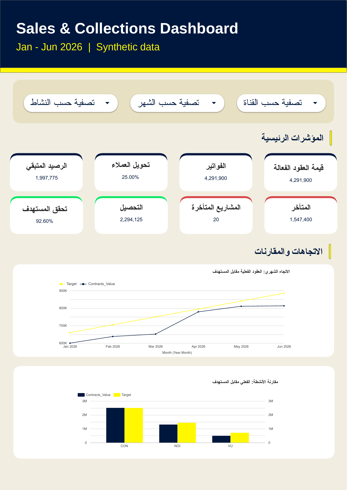
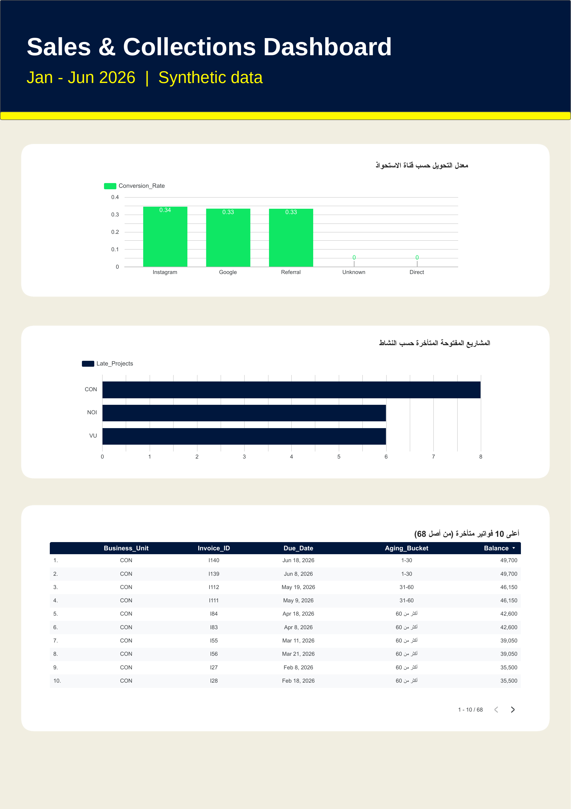

# Sales & Collections Analytics Dashboard

An end-to-end analytics case study: raw operational data is cleaned, modelled, validated and presented in an interactive management dashboard with an executive summary.

> **Data note:** the project runs on a fully synthetic dataset created for practice. It contains no real customer or company data.

## Dashboard





## Business Context

A multi-activity business (three business units) needed one view that connects **sales, invoicing, collections, marketing leads and project delivery** for the period **Jan 1 – Jun 30, 2026**, with a fixed report date of **Jun 30, 2026**.

| Code | Business unit |
|------|---------------|
| VU   | Interior design |
| NOI  | Events |
| CON  | Contracting |

## Data Model

Six source tables, kept untouched in `RAW_*` sheets and processed in separate `CLEAN_*` sheets:

```
Leads 1 ── 0..1 Contracts 1 ── N Invoices 1 ── N Payments
                    │
                    └── 0..1 Projects

Targets: one row per Month + Business Unit (joined by aggregating contracts to month and unit)
```

The main modelling risk was **fan-out**: joining contracts to invoices and payments repeats the contract value on every child row. This was handled by:

- building an `Invoice_Balance` table with exactly one row per invoice (invoiced, collected, balance, due date, days overdue);
- calculating contract value directly from the contracts table, never through invoices or payments;
- keeping targets at month + unit grain, so a target is never repeated per contract.

## Data Quality Log

| Table | Issue | Records | Decision | Impact |
|-------|-------|---------|----------|--------|
| Leads | Duplicate `Lead_ID` | 3 | Remove exact duplicates only | 363 → 360 leads |
| Leads | Channel names with stray spaces / mixed case | 3 | `TRIM` + `PROPER` | Names standardised, count unchanged |
| Leads | Blank channel | 4 | Labelled `Unknown` | Leads stay in the analysis |
| Contracts | Cancelled contracts | 6 | Kept in CLEAN, excluded from value and target in the model | Lower active value |
| Invoices | Duplicate invoice | 1 | Remove exact duplicate | 169 → 168 invoices |
| Payments | Duplicate payment | 1 | Remove exact duplicate | 212 → 211 payments |
| Payments | Payment pointing to a non-existent invoice | 1 | Moved to `QUARANTINE` | 750 excluded from collections |
| Payments | Negative payment amount | 1 | Moved to `QUARANTINE` | -500 excluded from collections |
| Projects | Blank `Actual_End` | 33 | Kept blank = project still open | Feeds the late-projects metric |

Keys, duplicates, blanks and foreign-key links were also checked on contracts, projects and targets; no changes were needed (90 contracts, 84 projects, 18 target rows).

## KPI Definitions

| KPI | Definition |
|-----|------------|
| Active contract value | Sum of `Contract_Value` for **Active** contracts, by signing date |
| Target achievement | Active contract value ÷ sum of `Sales_Target` for the selected months and units (not an average of unit percentages) |
| Invoiced | Sum of `Invoice_Amount` by issue date |
| Collected | Sum of accepted `Payment_Amount` by payment date, up to the report date |
| Balance | Invoice amount − accepted payments as of Jun 30 |
| Overdue | Positive balance with `Due_Date` before the report date |
| Aging buckets | Not overdue / 1–30 / 31–60 / 60+ days |
| Lead conversion | Unique `Won` leads ÷ unique leads, by created date |
| Late open projects | `Actual_End` blank and `Planned_End` before Jun 30 |

Collections and overdue balances are a **snapshot at the end of June** and do not change with the month filter. Channel applies to lead analysis only.

## Headline Results

| Metric | Value |
|--------|-------|
| Active contract value | 4,291,900 |
| Invoiced | 4,291,900 |
| Collected | 2,294,125 (53.5%) |
| Remaining balance | 1,997,775 |
| Overdue balance | 1,547,400 across 68 invoices |
| Target achievement | 92.6% |
| Lead conversion | 25.0% (90 won of 360) |
| Late open projects | 20 (CON 8 · NOI 6 · VU 6) |

## Validation

- **Reconciliation:** total invoiced (4,291,900) matches total active contract value (4,291,900), which confirms no duplication after joining.
- **Before / after cleaning:** record counts before and after each cleaning step are documented in the log above.
- **Excluded records:** invalid payments are isolated in a separate `QUARANTINE` sheet instead of being deleted, so their effect on collections stays visible.

## Key Insights

1. **The collection gap is concentrated in one unit.** Only 53.5% of invoiced value was collected, and all of the top 10 overdue invoices (35,500–49,700 each) belong to CON, even though CON is the closest to its sales target. The issue is the collection process, not sales performance.
2. **Two acquisition channels convert at exactly 0%.** Instagram, Google and Referral convert at 33–34%, while Direct (89 leads) and Unknown convert at 0%. A perfect zero points to a possible tagging or logging issue that needs verifying before any marketing decision.
3. **VU is clearly behind its target.** 489,200 achieved vs 705,000 target (69%), against 99.9% for CON and 91% for NOI, and it carries 6 late open projects, the same as NOI, on a much smaller volume of work.

## Recommended Actions

| Priority | Action | Owner | Tracking metric |
|----------|--------|-------|-----------------|
| 1 | Review the CON collection cycle: find the reasons behind the top 10 overdue invoices, contact the clients, review payment terms | Finance / Collections | Monthly CON collection rate; invoices overdue 60+ days |
| 2 | Audit Direct and Unknown channel records on a sample to confirm correct classification, then decide on budget | Marketing / Sales | Monthly conversion per channel; share of `Unknown` leads |
| 3 | VU recovery plan: review the pipeline and speed up closing of the 6 late projects | Sales (VU) with Project Management | Monthly VU target achievement; late open projects |

**What the data proves vs. what needs verification:** the collection concentration, the VU shortfall and the zero conversion are visible in the data. The *reasons* behind them (client behaviour, channel tagging, pipeline quality) require follow-up checks.

## Limitations

- No cost or revenue-recognition data, so net profit and margin cannot be calculated reliably. Cost data and revenue-recognition rules would be needed.
- Contract value is contractual sales, not recognised accounting revenue.
- Currency is SAR, all values excluding tax.

## Tools & Skills Demonstrated

Google Sheets (FILTER, UNIQUE, LET, SUMIFS, COUNTIFS), Looker Studio, data cleaning and validation, relational data modelling, KPI design, reconciliation testing, dashboard design, and management reporting.

## Repository Structure

```
├── README.md
└── images/
    ├── dashboard_overview.png
    └── dashboard_collections_and_operations.png
```

## Author

روان منصور
